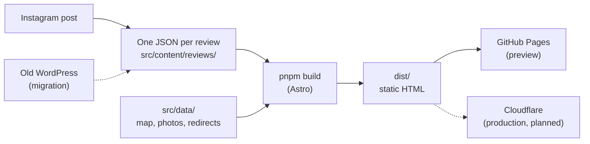
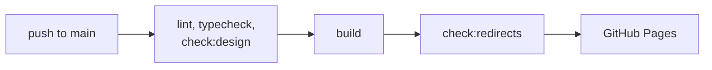

# Alberto de Luna

The restaurant review site of [Alberto de Luna](https://www.instagram.com/alberto_deluna/), who scores every place in **lunas** (moons), from 0 to 10. It's a static Astro site that will replace the old WordPress site (dimeunrestaurante.com) and live at **albertodeluna.com**.

> For now the repo only holds the 7 reviews that came from his Instagram (October and November 2026). The ~720 WordPress reviews, going back to 2010, will be migrated again.

## How it works

Each review is a JSON file. Astro reads them at build time and renders every page as static HTML, with no server and no database.



The reviews produce these pages:

| Page | Path |
| --- | --- |
| Home | `/` |
| All reviews, with filters | `/restaurantes/` |
| A review | `/restaurantes/<id>/` |
| Moon map | `/mapa` |
| How he scores | `/como-puntuo` |
| Seal for the restaurant | `/sello/` and `/sello/<id>/` |

Social share images (`/og/*.png`) and downloadable seals (`/sello/*.svg`) are also rendered at build time.

## Run it

Needs Node 22 or later and [pnpm](https://pnpm.io).

```bash
pnpm install
pnpm dev
```

The site opens at http://localhost:4321.

| Command | What it does |
| --- | --- |
| `pnpm dev` | Development server |
| `pnpm build` | Builds the site into `dist/` |
| `pnpm preview` | Serves `dist/` to check the build |
| `pnpm lint` | ESLint |
| `pnpm typecheck` | Type checks (`astro check`) |
| `pnpm check:design` | Checks that only the colours and brand from `DESIGN.md` are used |
| `pnpm check:redirects` | After a build: fails if an old URL redirects to a page that no longer exists |

## Where things live

```text
src/
  content/reviews/   one review per JSON file (the file name is its URL)
  content.config.ts  the review schema
  data/              coordinates (geo.json), dish photos and old URLs
  pages/             the pages
  components/        reusable pieces (the moon, the review row…)
  styles/global.css  colours and typography
public/              Instagram photos, hero video and favicon
scripts/             tools (photos, geocoding, checks, migration)
docs/plan.md         hosting plan and Instagram publishing pipeline
```

## Adding a review

1. Create `src/content/reviews/<id>.json` with the fields in [`content.config.ts`](src/content.config.ts). The `<id>` becomes its URL.
2. Put its photos in `public/img/ig/` and make the 800px copies with `node scripts/photos.mjs`.
3. To show it on the map, add its coordinates with `node scripts/geocode.mjs`.

The plan is for a pipeline to do this on its own, turning Instagram posts into pull requests (see [docs/plan.md](docs/plan.md)).

## Deploy



Every push to `main` runs the checks and publishes a preview at `https://<owner>.github.io/<repo>/`, currently https://kaizencode-sl.github.io/albertodeluna/ ([pages.yml](.github/workflows/pages.yml)). The preview is kept out of search engines. For it to work, the repo needs Pages enabled with *GitHub Actions* as the source.

Production will run on Cloudflare. The plan is in [docs/plan.md](docs/plan.md).

## More docs

- [PRODUCT.md](PRODUCT.md): who it's for, the voice and the brand.
- [DESIGN.md](DESIGN.md): the design system (colours, type, components, motion).
- [CLAUDE.md](CLAUDE.md): project rules for working with Claude Code.
